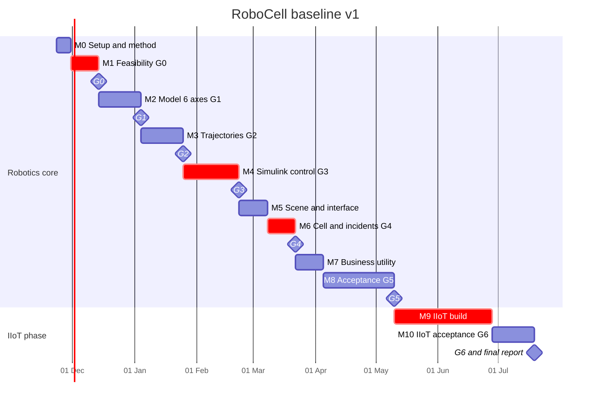

# Project plan (baseline v1)

Assumption: 10 h per week, start Monday 23 November 2026. Dates are targets and
are adjusted at each weekly review (baseline stays untouched, replans are v2, v3).

| Mission | Effort (h) | Target end |
|---|---|---|
| M0 | 6 | 29 Nov 2026 |
| M1 | 14 | 13 Dec 2026 |
| M2 | 25 | 3 Jan 2027 |
| M3 | 22 | 24 Jan 2027 |
| M4 | 34 | 21 Feb 2027 |
| M5 | 16 | 7 Mar 2027 |
| M6 | 16 | 21 Mar 2027 |
| M7 | 12 | 4 Apr 2027 |
| M8 | 27 + 16 reserve | 9 May 2027 |
| M9 | about 59 | 27 Jun 2027 |
| M10 | about 16 + report | 18 Jul 2027 |

## Weekly review routine (Sunday, 20 minutes)
1. Fill docs/time-log.csv (date, mission, hours, note).
2. Compute PV, EV, AC, SPI, CPI.
3. Update status in requirements.csv and README.
4. If SPI is below 0.85 two weeks in a row: use reserve or cut scope, write the decision here.